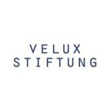

::::: {.columns}

:::: {.column width="60%"}

We are delighted to announce that **PlantForAdapt** has been selected for funding by the [Velux Stiftung](https://veluxstiftung.ch/) under its 2026 Forestry call.

::::

:::: {.column width="5%"}
::::

:::: {.column width="35%"}

::::

:::::

The Velux Stiftung is a Swiss philanthropic foundation that supports research and projects in areas such as forestry, with a focus on long-term, high-impact initiatives.

This funding will allow us to launch our international collaboration between Brazil and France on native-species planted forests, and to develop science-based guidelines for resilient Amazonian landscapes in the face of global change.

Stay tuned for more updates as the project gets underway!

<!--Include social share buttons-->


