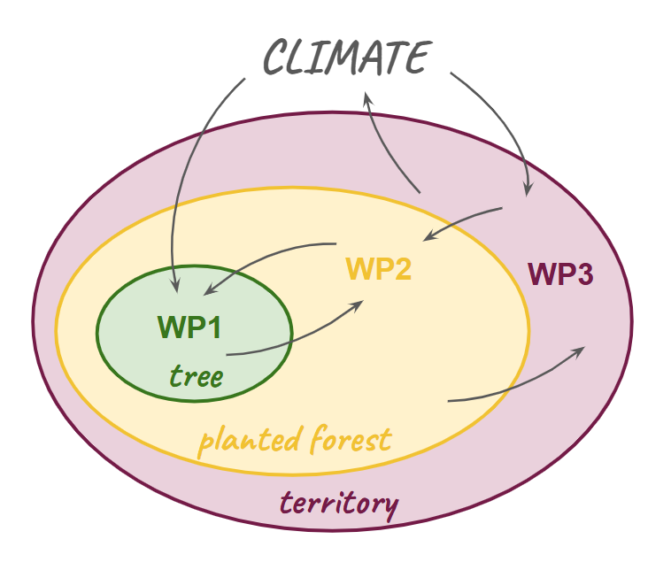
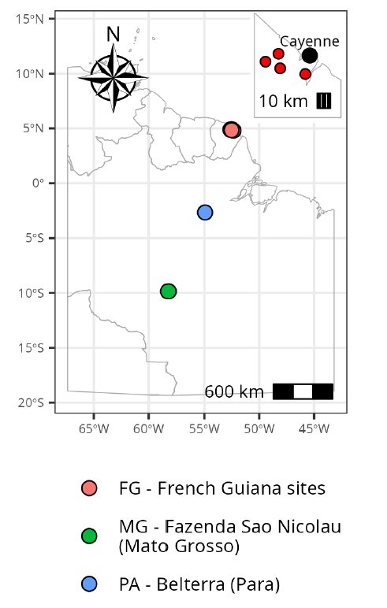

## Context

Amazonian forests, and their biodiversity and Nature Contribution to people, are increasingly threatened by deforestation, degradation and climate change.
Brazil and French Guiana thus share the challenge of conserving and restoring their forests while promoting development, meeting an increasing timber demand and ensuring the well-being of their populations in a context where agricultural expansion and other land-use pressures also compete for forested land.
Planted forests with native species represent an alternative to selective logging in natural forests and exotic species monocultures plantations, and can reconcile conservation of biodiversity with a diversified provision of wood products.
In the face of climate change uncertainty, increasing diversity of planted species can improve planted forests resilience.
However, the expansion of resilient and productive mixed forests with native species has thus far been constrained by critical knowledge gaps on tree species and the limited scientific basis for silvicultural guidelines, especially in a context of uncertainty related to their vulnerability to climate change.
To ensure the resilience of planted forests to natural hazards, we thus crucially need the scientific basis for the selection of suitable candidate species within the immense diversity of native tree species, and the understanding of the effect of management practices on stand productivity and resilience.
But this knowledge alone will not foster the adoption of plantations with native species unless it is confronted with the realities of the stakeholders likely to implement these practices.
The success of this transformative change of practices therefore also depends on a solid understanding of the stakeholders’ perspectives.

## Objectives

PlantForAdapt proposes a science-based interdisciplinary approach to tackle the gaps in knowledge on planted forests with native species and drive transformative changes in the management of these forests in Amazonia, aiming to enhance NCP in the face of climate uncertainties.
It aims to study the potential of the high native tree biodiversity to propose innovative practices that can increase the resilience of planted forest to climate change and to provide a diversity of raw wood material and Nature Contribution to People.
It will leverage long-term data from planted forests sites covering a diversity of practices and socio-environmental context, and analyse them through diverse modelling approaches to understand the dynamics of these forests.
Through a strong involvement of key stakeholders throughout the project, PlantForAdapt will contribute to the adoption of forestry practices based on planted forests with natives species by tackling some of the critical research needs on the ecology of these forests, and identifying opportunities and potential additional barriers encountered by a diversity of stakeholders in two socio-economically contrasted contexts (Brazilian Amazon and French Guiana).
The project will also foster transboundary collaboration between France (French Guiana) and Brazil, two territories sharing the same stake of promoting alternative and sustainable wood production practices in the face of climate change.

## Scientific hypothesis

PlantForAdapt is based on the hypothesis that leveraging the high biodiversity of native tree species can enhance planted forest productivity and their resilience to climate change.
Fostering species diversity in managed forests is a "no-regret approach" to climate-smart forestry, offering a scalable solution to ensure ecological functioning and NCP, including timber provision .
Various mechanisms have been proposed to explain the effects of tree diversity on resource use and forest functioning, with consequences on tree, water and temperature stresses and wood production stability.
More diverse forests can stabilises productivity by enhancing species asynchrony.
In addition, biotic interactions between trees can improve forest productivity and resilience through resource partitioning and facilitation.
However, beneficial effects of tree diversity may be overridden by competition in certain tree mixtures, especially during severe drought.

## Project organisation

:::::: columns
::: {.column width="50%"}
PlantForAdapt is organised around two biophysical work packages (WP1 and 2) and a third WP fostering stakeholder engagement.
WP 1 will produce knowledge on native species potential for planted forests, and WP2 on the interest of mixed-species practices to increase planted forests resilience, two topics highlighted as critical research priorities for planted forests with native species 10,28 .
By analysing stakeholder barriers and opportunities to adoption of planted forests with native species, WP3 will facilitate the co-design of practices grounded in stakeholders’ realities.
:::

::: {.column width="5%"}
:::

::: {.column width="45%"}

:::
::::::

**WP1 - Characterising native species potential and their response to climate change**
*lead: R. Lehnebach & S. Schmitt*
  
  * Native species' intrinsic demographic performance and their response to extreme climate events
  * Potential of native species for wood and non-timber forest products
  

**WP2 - Leveraging the diversity of mixed-species planted forests to increase resilience**
*lead: G. Derroire & L. Mazzei*
  
  * Effect of diversity on productivity of planted forests and their response to climate change
  * Effect of planted trees on natural regeneration

**WP3 - Analysing opportunities and barriers to stakeholder adoption of planted forests with native species**
*lead: A. Perrotton & I. Tritsch*
  
  * Stakeholder engagement, typology of planters, and participatory exploration of innovations
  * Economic assessment of plantation development

## Study sites

:::::: columns
::: {.column width="35%"}

:::

::: {.column width="5%"}
:::

::: {.column width="60%"}

[**Fazenda São Nicolau**](https://onfbrasil.com.br/fazenda-sao-nicolau/) (Mato Grosso, Brazil): managed by ONF Brazil, this site hosts 1700 ha of forest planted 20 years ago with more than 50 native species planted with 85 different designs.

**French Guiana**: 4 experimental sites managed by the ONF (Arboretum de l’Egyptienne, Piste Christine, Arboretum de Macouria and Tonnegrande) covering a total of 20 ha, with 6-13 species tested in each.

**Belterra experiment** (Pará, Brasil): managed by Embrapa, hosts 96 ha planted with 19 native and exotic species in the 1970s, with different planting spacings between trees, provenances, and fertilization.

:::
::::::

## Stakeholder engagement

PlantForAdapt takes a participatory approach, working with stakeholders throughout the project.
Workshops, field interviews and scenario-building exercises in each study site bring together forest managers, landowners, companies and institutions to share their visions and needs, and to co-design innovations that are both feasible and socially acceptable.

The project engages two main groups of stakeholders:

- **Key institutional stakeholders at the national level**, who shape forest policy and management: the French Forest Service (ONF) and the Technical Centre of Wood and Forests (CTBFG) in French Guiana, and the Brazilian Forest Service (SFB) and the Research and Development Program on Silviculture of Native Species (PP&D-SEN) in Brazil. Project results will give them scientific evidence to inform national strategies for forest restoration and sustainable timber production.

- **Operational actors**, who establish and manage plantations: mainly landowners in Brazil, who must conserve or restore part of their land under the Forest Code, and private and public operators in French Guiana, where the plantation sector is still emerging. Project results will clarify the technical and economic feasibility of using native species in restoration, while meeting legal obligations.

A [steering committee](people.qmd#committee) composed of project collaborators and national-level institutional stakeholders keeps the research anchored in operational realities.
Final seminars in each project site and in Brasilia will help turn results into policy briefs and practical guidance for native species plantations.

## Expected outputs and impact

<!-- a terminer-->


